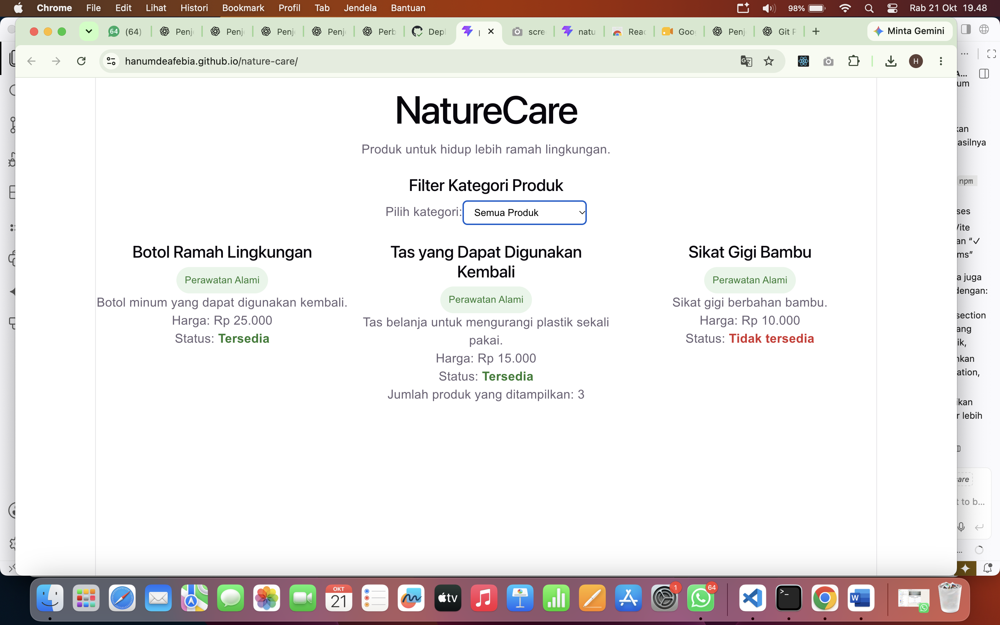

# Nature Care 🌿

## Deskripsi Proyek
Nature Care adalah aplikasi berbasis React dan Vite untuk menampilkan produk ramah lingkungan. Aplikasi ini menampilkan nama produk, manfaat, harga, dan status ketersediaan.

## Screenshot Aplikasi



## Teknologi yang Digunakan
- React
- Vite
- JavaScript
- CSS
- Git dan GitHub


## Daftar Komponen dan Props

### 1. App

File: `src/App.jsx`

Komponen utama yang menampilkan judul aplikasi, deskripsi, filter kategori, dan daftar produk.

Fungsi:
- Menampilkan daftar produk Nature Care.
- Memfilter produk berdasarkan kategori.
- Menghitung jumlah produk yang ditampilkan.

### 2. Naturecare

File: `src/components/Naturecare.jsx`

Komponen untuk menampilkan informasi setiap produk.

Props yang digunakan:

| Props | Tipe Data | Keterangan |
|---|---|---|
| `nama` | String | Nama produk |
| `manfaat` | String | Manfaat produk |
| `harga` | Number | Harga produk |
| `tersedia` | Boolean | Status ketersediaan produk |

Contoh penggunaan:

```jsx
<Naturecare
  nama="Eco Bottle"
  manfaat="Botol minum yang dapat digunakan kembali."
  harga={25000}
  tersedia={true}
/>
```

## Cara Menjalankan Proyek

Pastikan Node.js dan npm sudah terpasang di komputer.

### 1. Clone repositori

```bash
git clone https://github.com/hanumdeafebia/nature-care.git
```

### 2. Masuk ke folder proyek

```bash
cd nature-care
```

### 3. Instal dependensi

```bash
npm install
```

### 4. Jalankan aplikasi

```bash
npm run dev
```

Buka alamat lokal yang ditampilkan di terminal, biasanya `http://localhost:5173`.

## Fitur Aplikasi

- Menampilkan daftar produk ramah lingkungan.
- Menampilkan nama, manfaat, dan harga produk.
- Menampilkan status ketersediaan produk.
- Memfilter produk berdasarkan kategori.
- Menampilkan jumlah produk sesuai filter.

## Penggunaan AI

AI digunakan sebagai alat bantu selama pengembangan proyek, antara lain untuk:
- Membantu memahami struktur proyek React dan Vite.
- Memberikan saran dalam penulisan komponen dan CSS.
- Membantu memahami Git, commit, branch, dan pull request.
- Membantu konfigurasi deployment ke GitHub Pages.
- Membantu menyusun dokumentasi proyek.

Kode dan hasil pengembangan tetap diperiksa dan diuji agar sesuai dengan kebutuhan proyek.

## Deployment

Aplikasi dipublikasikan menggunakan GitHub Pages.

Alamat aplikasi: https://hanumdeafebia.github.io/nature-care/

## Pengembang

Proyek Nature Care dikembangkan sebagai latihan pengembangan aplikasi web menggunakan React dan Vite.